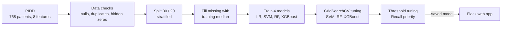
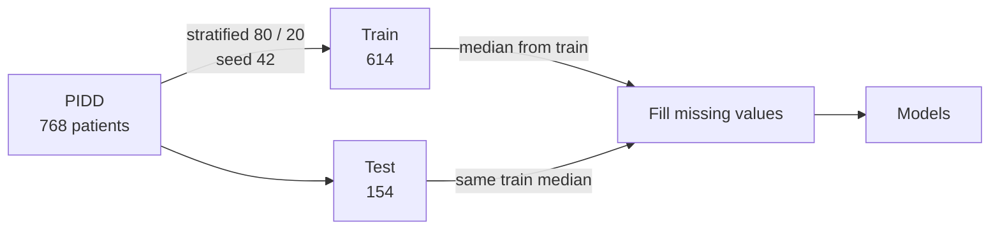
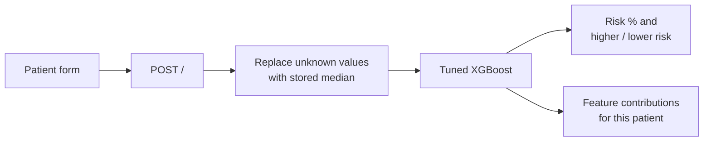

<div align="center">

# Diabetes Risk Prediction
**Machine learning on patient medical data, with a tuned XGBoost model and a risk screening web app**

**CodeAlpha Machine Learning Internship, Task 4: Disease Prediction from Medical Data**

[](https://www.python.org/)
[](https://scikit-learn.org/)
[](https://xgboost.readthedocs.io/)
[](https://flask.palletsprojects.com/)
[](LICENSE)

</div>

---

## Overview

This project uses the
[Pima Indians Diabetes Dataset (PIDD)](https://data.mendeley.com/datasets/7zcc8v6hvp/1) to predict whether a
patient has diabetes from eight medical measurements such as glucose, BMI and age. Four classification
algorithms (Logistic Regression, SVM, Random Forest and XGBoost) are compared, three of them are tuned with `GridSearchCV`, and the
final model is served in a small **Flask web app** that shows a risk estimate for one patient.

Because missing a diabetic patient is worse than a false alarm, the project looks at **Recall** as well as
accuracy, and the decision threshold of the final model is lowered on purpose.

The work is split into three parts:

- **Data preparation.** The data is checked for nulls and duplicates. Many `0` values turn out to be hidden
  missing values, so they are converted to `NaN` and filled with the training median **after** the
  train/test split, to avoid data leakage.
- **Models.** Four models are trained and compared. SVM, Random Forest and XGBoost are tuned with
  `GridSearchCV`. A lower decision threshold is then chosen from the training data to raise Recall.
- **Web app.** The saved model is loaded by a Flask app. The user enters the patient's values and gets a risk
  percentage, a higher/lower risk result, and charts that show which features drove the prediction.



### Key results

| Aspect | Result |
|---|---|
| Dataset | Pima Indians Diabetes, 768 patients, 8 features, 2 classes (500 non-diabetic, 268 diabetic) |
| Hidden missing values | `0` used as "missing" in 5 columns, up to 48.7% of Insulin and 29.6% of SkinThickness |
| Models compared | Logistic Regression, SVM, Random Forest, XGBoost |
| Best model | **Tuned XGBoost** (learning rate 0.03, depth 2, 200 trees) |
| Test results at threshold 0.5 | Accuracy **0.766**, Precision 0.629, Recall **0.815**, F1 **0.710** |
| Screening threshold | **0.3** (chosen from training data), Recall rises to **0.907** |
| Cost of the lower threshold | False alarms rise from 26 to 42 (of 100 healthy test patients), Precision falls to 0.538 |
| Diabetic patients missed (of 54) | 10 at threshold 0.5, 5 at threshold 0.3 |
| Most important features | Glucose, then BMI, then Age |
| Web app | Enter 8 values, get a risk %, a higher/lower risk result, and feature contribution charts |

---

## Table of contents

1. [Datasets](#1-datasets)
2. [Notebook and app](#2-notebook-and-app)
3. [Data preparation](#3-data-preparation)
4. [Models and training](#4-models-and-training)
5. [Results](#5-results)
6. [Error analysis](#6-error-analysis)
7. [Web app](#7-web-app)
8. [Reproducing the results](#8-reproducing-the-results)
9. [Limitations](#9-limitations)
10. [Repository structure](#10-repository-structure)
11. [License and references](#11-license-and-references)

---

## 1. Datasets

One public dataset was used. The train and test sets are derived from it inside the notebook.

| # | Dataset | Type | Built from | Used in | Link |
|---|---|---|---|---|---|
| 1 | Pima Indians Diabetes Dataset (PIDD) | Public, original | n/a | Source for dataset 2 | [Mendeley Data](https://data.mendeley.com/datasets/7zcc8v6hvp/1) |
| 2 | Train and test sets | Derived in the notebook | PIDD | Training, tuning and testing | `notebook/Disease_Prediction.ipynb` |



### 1.1 Pima Indians Diabetes Dataset (original dataset)

| Property | Value |
|---|---|
| Source | [Diabetes Datasets, Mendeley Data](https://data.mendeley.com/datasets/7zcc8v6hvp/1) (file: *Dataset 1, Pima Indians diabetes dataset (PIDD).xlsx*) |
| Contributors | Lionel Prakasah Joseph, Erica Angelic Joseph, Ramendra Prasad (Mendeley Data, version 1, published 15 August 2022) |
| DOI | [10.17632/7zcc8v6hvp.1](https://doi.org/10.17632/7zcc8v6hvp.1) |
| Licence | CC BY 4.0 |
| Original data | National Institute of Diabetes and Digestive and Kidney Diseases (NIDDK), via the UCI Machine Learning Repository |
| Content | Medical measurements of patients and a diabetes label |
| Patients | 768 |
| Features | 8 numeric features |
| Target | `Outcome` (1 = diabetic, 0 = non-diabetic) |
| File in this repository | `data/Pima_Indians_diabetes_dataset(PIDD).xlsx` |
| Main difficulty | Many `0` values that really mean "not measured", and only 768 rows |

| Feature | Unit (as used in the web app form) |
|---|---|
| Pregnancies | Count |
| Glucose | mg/dL |
| Blood pressure | mmHg |
| Skin thickness | mm |
| Insulin | mu U/ml |
| Body mass index | BMI |
| Diabetes pedigree function | A score related to family history of diabetes |
| Age | Years |

The classes are imbalanced: 500 non-diabetic patients (65.1%) and 268 diabetic patients (34.9%).

### 1.2 Train and test sets (derived dataset)

Created in the notebook. They are not published as separate files.

| Property | Value |
|---|---|
| Method | Stratified split, 80 / 20, seed 42 |
| Train | 614 patients (400 non-diabetic, 214 diabetic) |
| Test | 154 patients (100 non-diabetic, 54 diabetic) |
| Used for | Train: model fitting, tuning and threshold choice. Test: the scores of all models and of the final model |

**Design decisions**

- **The split comes before any filling or scaling.** The median used to fill missing values is taken from the
  training set only and then applied to both sets. The scaler is also fitted on the training set only.
- **The classes are not resampled.** Class imbalance is handled with `class_weight="balanced"` (Logistic
  Regression, SVM, Random Forest) and `scale_pos_weight` (XGBoost, about 1.87).
- **The threshold is chosen without the test set.** It comes from cross-validated predictions on the training
  data.

---

## 2. Notebook and app

| File | Description |
|---|---|
| `notebook/Disease_Prediction.ipynb` | Full pipeline: data checks, hidden missing values, EDA, four models, tuning, threshold tuning, feature importance |
| `app.py` | Flask app that loads the saved model and returns a risk estimate |
| `templates/index.html` | Web page with the patient form and the result |
| `static/style.css` | Page styling |
| `notebook/diabetes_xgb_model.joblib` | Tuned XGBoost model used by the app |
| `notebook/model_config.json` | Threshold, feature order and the median values used for unknown inputs |

---

## 3. Data preparation

### 3.1 Data checks

| Check | Result |
|---|---|
| Null values | 0 |
| Duplicate rows | 0 |
| Data types | All numeric |

`isnull()` finds nothing, but the data still has a problem: a value of `0` is impossible for some features.

### 3.2 Hidden missing values

For five features a `0` is not a possible measurement (a living person does not have a glucose or BMI of 0), so
these zeros are treated as missing values. For `Pregnancies` and `Outcome` a `0` is a real value, so they were
left alone.

| Feature | Zeros | Share of 768 |
|---|---:|---:|
| Glucose | 5 | 0.7% |
| Blood pressure | 35 | 4.6% |
| Skin thickness | 227 | 29.6% |
| Insulin | 374 | 48.7% |
| Body mass index | 11 | 1.4% |

These zeros were replaced with `NaN`, and the gaps are filled with the **median** of the training set (after the
train/test split).

| Feature | Training median |
|---|---:|
| Glucose | 117 |
| Blood pressure | 72 |
| Skin thickness | 29 |
| Insulin | 125 |
| Body mass index | 32.4 |

### 3.3 Exploratory analysis

| Finding | Detail |
|---|---|
| Strongest link with Outcome | Glucose (0.49), then BMI (0.31) and Insulin (0.30) |
| Weakest links with Outcome | Blood pressure and pedigree function (both 0.17) |
| Features that move together | SkinThickness and BMI (0.65), Glucose and Insulin (0.58), Age and Pregnancies (0.54) |
| Diabetes rate by age | About 22% at 21-30, 48% at 31-40, 57% at 41-50 and 47% at 50+ |

No feature was removed.

### 3.4 Preprocessing and split

| Step | Applied to | Why |
|---|---|---|
| Stratified 80 / 20 split | All data | Keep the class mix equal in train and test |
| Fill `NaN` with the training median | Train and test | Models cannot handle missing values |
| `StandardScaler` (fitted on train) | Logistic Regression and SVM only | These models are sensitive to feature scale |
| No scaling | Random Forest and XGBoost | Tree models do not need it |

---

## 4. Models and training

### 4.1 Models

| Model | Settings | Input |
|---|---|---|
| Logistic Regression | `class_weight="balanced"`, `max_iter=1000` | Scaled |
| SVM | RBF kernel, `class_weight="balanced"` | Scaled |
| Random Forest | 300 trees, `class_weight="balanced"` | Not scaled |
| XGBoost | 200 trees, learning rate 0.05, depth 3, `scale_pos_weight` about 1.87 | Not scaled |

SVM, Random Forest and XGBoost use `random_state=42`. Logistic Regression has no random seed set.

### 4.2 Training protocol

| Setting | Value |
|---|---|
| Split | Stratified 80 / 20, seed 42 (614 train, 154 test) |
| Missing values | Filled with the median of the training set |
| Scaling | `StandardScaler` fitted on the training set (Logistic Regression and SVM only) |
| Class imbalance | `class_weight="balanced"` and `scale_pos_weight` (about 1.87) |
| Tuning | `GridSearchCV`, 5 folds, F1 score, training data only (SVM, Random Forest, XGBoost) |
| Metrics | Accuracy, Precision, Recall, F1 |
| Random seed | 42 (SVM, Random Forest, XGBoost) |

### 4.3 Hyperparameter tuning

SVM, Random Forest and XGBoost were tuned with `GridSearchCV` (5 folds, F1 score, training data only).
Logistic Regression was not tuned.

| Model | Grid | Best setting | Best CV F1 |
|---|---|---|---:|
| SVM | C (0.1, 1, 10), kernel (linear, rbf), gamma (scale, 0.01, 0.1) | C = 1, rbf, gamma = 0.01 | 0.676 |
| Random Forest | trees (100, 300), depth (3, 5, none), min leaf (1, 3, 5) | 300 trees, depth 5, min leaf 1 | 0.699 |
| XGBoost | depth (2, 3, 4), learning rate (0.03, 0.05, 0.1), trees (100, 200, 300) | depth 2, rate 0.03, 200 trees | 0.696 |

### 4.4 Threshold tuning

A model gives a probability, and the default rule says "diabetic" when it is 0.5 or higher. To miss fewer
diabetic patients, a lower threshold was chosen:

1. Get a cross-validated probability for every training patient (5 folds), so each probability comes from a
   model that did not see that patient.
2. Compute Precision and Recall for thresholds from 0.20 to 0.70 in steps of 0.05.
3. Keep the largest threshold that still gives a training Recall of at least 0.85. This is **0.30**
   (training Recall 0.883, Precision 0.512).

---

## 5. Results

All scores in this section are measured on the 154 test patients (54 diabetic).

### 5.1 Four models, before tuning

| Model | Accuracy | Precision | Recall | F1 |
|---|---:|---:|---:|---:|
| Logistic Regression | 0.734 | 0.603 | 0.704 | 0.650 |
| SVM | 0.727 | 0.591 | 0.722 | 0.650 |
| Random Forest | 0.740 | 0.617 | 0.685 | 0.649 |
| XGBoost | 0.747 | 0.619 | 0.722 | 0.667 |

The four models are close to each other: accuracy 73-75% and F1 0.65-0.67.

### 5.2 Before and after tuning

| Model | Accuracy | Precision | Recall | F1 |
|---|---:|---:|---:|---:|
| SVM | 0.727 | 0.591 | 0.722 | 0.650 |
| SVM (tuned) | 0.740 | 0.609 | 0.722 | 0.661 |
| Random Forest | 0.740 | 0.617 | 0.685 | 0.649 |
| Random Forest (tuned) | 0.740 | 0.600 | 0.778 | 0.677 |
| XGBoost | 0.747 | 0.619 | 0.722 | 0.667 |
| **XGBoost (tuned)** | **0.766** | **0.629** | **0.815** | **0.710** |

Tuned XGBoost has the best score on every metric, so it was chosen as the final model.

### 5.3 Effect of the threshold (tuned XGBoost)

| | Threshold 0.5 | Threshold 0.3 |
|---|---:|---:|
| Accuracy | 0.766 | 0.695 |
| Precision | 0.629 | 0.538 |
| Recall | 0.815 | **0.907** |
| F1 | 0.710 | 0.676 |

### 5.4 Feature importance (tuned XGBoost)

| Rank | Feature | Importance (about) |
|---:|---|---:|
| 1 | Glucose | 0.31 |
| 2 | BMI | 0.16 |
| 3 | Age | 0.12 |
| 4 | Insulin | 0.11 |
| 5 | Pregnancies | 0.09 |
| 6 | SkinThickness | 0.09 |
| 7 | DiabetesPedigreeFunction | 0.07 |
| 8 | BloodPressure | 0.05 |

Glucose is the clear leader, followed by BMI and Age. Importance values are read from the notebook's bar chart,
so they are approximate. Glucose and BMI also had the two strongest correlations with Outcome.

---

## 6. Error analysis

The test set has 100 non-diabetic and 54 diabetic patients. At threshold 0.5, **36 of 154** test patients were
misclassified (26 false alarms and 10 missed patients). At threshold 0.3, **47 of 154** were misclassified (42
false alarms and 5 missed patients). The two kinds of error are not equally serious: for diabetes, a missed
patient is worse than a false alarm, which is why the threshold was lowered.

**Errors on the test set (tuned XGBoost)**

| | Threshold 0.5 | Threshold 0.3 |
|---|---:|---:|
| Diabetic patients found (true positives) | 44 | 49 |
| Diabetic patients missed (false negatives) | **10** | **5** |
| Healthy patients flagged (false positives) | 26 | 42 |
| Healthy patients cleared (true negatives) | 74 | 58 |

**Discussion**

- Lowering the threshold from 0.5 to 0.3 halves the number of missed diabetic patients (10 to 5), but 16 more
  healthy patients are flagged as "higher risk".
- The notebook's reasoning: for a **screening** tool this is okay, because a false alarm only means one more
  test, while a missed patient gets no treatment.
- At 0.3, about 46% of the patients flagged as higher risk are actually healthy (Precision 0.538).
- The test set is small. A difference of one or two patients moves Recall by 2-4 points, so these numbers
  should be read as a range and not as exact values.

---

## 7. Web app

A small **Flask** app lets a user enter one patient's values and see the model's risk estimate.

### 7.1 Pipeline



| Setting | Value |
|---|---|
| Framework | Flask (development server) |
| Model files | `diabetes_xgb_model.joblib` and `model_config.json`, found in the project root or in `notebook/` |
| Front end | Plain HTML and CSS, no JavaScript |
| Decision rule | Higher risk when the probability is at least the threshold (0.30) |
| Routes | `/` (form and result), `/example/<name>` (loads an example patient) |
| Output | Risk as a percentage, a higher / lower risk result, feature contributions and overall feature importance |

### 7.2 Inputs and output

| Input | Allowed range | Can be "unknown" |
|---|---|:-:|
| Pregnancies | 0 to 20 | No |
| Age (years) | 18 to 100 | No |
| Diabetes pedigree function | 0 to 3 | No |
| Glucose (mg/dL) | 40 to 250 | Yes |
| BMI | 10 to 70 | Yes |
| Blood pressure (mmHg) | 30 to 140 | Yes |
| Skin thickness (mm) | 5 to 100 | Yes |
| Insulin (mu U/ml) | 10 to 900 | Yes |

If a value is marked **unknown**, the app uses the median value stored in `model_config.json` instead (the result
page says the training dataset median was used). The result page lists which values were replaced.

**What the result page shows**

| Part | Description |
|---|---|
| Risk and verdict | The risk as a percentage and a higher / lower risk result against the 0.30 threshold, with a progress bar |
| Unknown values note | Which inputs were replaced by the training median |
| Feature contributions | How much each feature pushed this patient's score up or down (XGBoost contribution values, unit: log-odds) |
| Overall feature importance | Which features the model relies on most in general |
| Example patients | Two buttons that fill the form with a higher-risk and a lower-risk patient |

### 7.3 Usage

```bash
python app.py
```

Open `http://127.0.0.1:5000`, enter the values (or press an example button) and click **Calculate Risk**.

---

## 8. Reproducing the results

**1. Install**

```bash
git clone <your-repo-url>
cd CodeAlpha_Disease_Prediction

python -m venv env
env\Scripts\activate          # Windows
# source env/bin/activate     # macOS / Linux

pip install -r requirements.txt
```

**2. Run the web app** (uses the already trained model)

```bash
python app.py
```

**3. Re-run the notebook** (optional, to retrain)

Open `notebook/Disease_Prediction.ipynb` and select **Restart and Run All**. The notebook reads the data from
`../data/Pima_Indians_diabetes_dataset(PIDD).xlsx`, so it must be opened from inside the `notebook/` folder.
The trained model and its settings are kept in the `notebook/` folder (`diabetes_xgb_model.joblib` and
`model_config.json`).

Run order inside the notebook:

```text
Libraries -> Data load -> Checks (null, zero, duplicate) -> Hidden missing values -> EDA
          -> Split -> Fill with train median -> Scaling -> 4 models
          -> Comparison -> GridSearchCV -> Threshold tuning -> Feature importance
```

The Random Forest grid search takes the longest.

---

## 9. Limitations

- The dataset is small (768 patients) and only contains Pima Indian women aged 21 and older. The model may not
  work for other groups.
- The test set has only 54 diabetic patients, and only one train/test split (seed 42) was used, so the scores
  can change with another split.
- The final model was chosen by comparing test scores, so its test result is a little optimistic.
- Many Insulin values (48.7%) and SkinThickness values (29.6%) are filled with a single median, so they are not
  real measurements.
- The threshold of 0.3 follows a Recall target of 0.85 on training data. On the test set it gives 16 more false
  alarms (26 to 42 of 100 healthy patients) and 5 fewer missed diabetic patients (10 to 5 of 54).
- Logistic Regression was not tuned, and only the tree models and the SVM were searched over small grids.
- The web app checks the input ranges in the browser form only, runs on the built-in development server
  (`debug=True`), and is meant for local demonstration.
- This is a learning project. It is **not a medical device** and cannot replace a doctor.

---

## 10. Repository structure

```text
├── app.py                              Flask app (loads the model, returns the risk)
├── templates/
│   └── index.html                      Web page with the patient form and result
├── static/
│   └── style.css                       Page styling
├── notebook/
│   ├── Disease_Prediction.ipynb        Data checks, EDA, models, tuning, threshold, importance
│   ├── diabetes_xgb_model.joblib       Tuned XGBoost model
│   └── model_config.json               Threshold, feature order, median values
├── data/
│   └── Pima_Indians_diabetes_dataset(PIDD).xlsx   PIDD dataset
├── requirements.txt
├── .gitignore
├── LICENSE
└── README.md
```

---

## 11. License and references

The license of the code in this repository is given in the [LICENSE](LICENSE) file. Third-party components are
subject to their own licenses: scikit-learn, XGBoost, Flask, and the Pima Indians Diabetes dataset (CC BY 4.0, Mendeley
Data).

**References**

1. L. P. Joseph, E. A. Joseph, R. Prasad. *Diabetes Datasets.* Mendeley Data, Version 1, 2022.
   [doi:10.17632/7zcc8v6hvp.1](https://doi.org/10.17632/7zcc8v6hvp.1).
2. J. W. Smith, J. E. Everhart, W. C. Dickson, W. C. Knowler, R. S. Johannes. *Using the ADAP Learning Algorithm
   to Forecast the Onset of Diabetes Mellitus.* Proceedings of the Symposium on Computer Applications and
   Medical Care, 1988.
3. T. Chen, C. Guestrin. *XGBoost: A Scalable Tree Boosting System.* KDD, 2016.
4. F. Pedregosa et al. *Scikit-learn: Machine Learning in Python.* Journal of Machine Learning Research, 2011.
